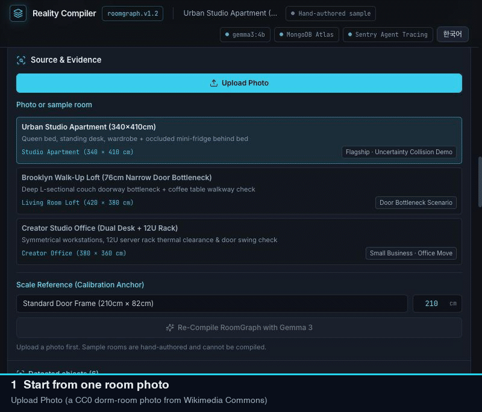
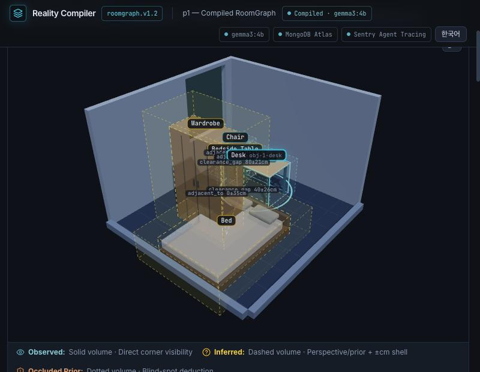
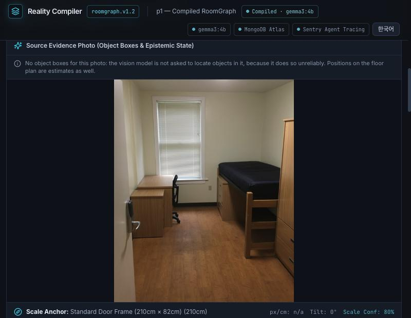
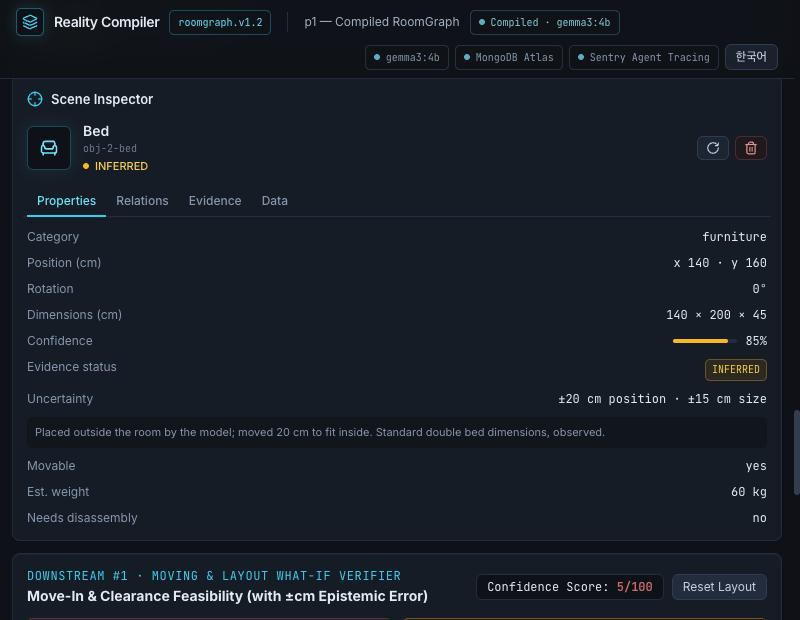
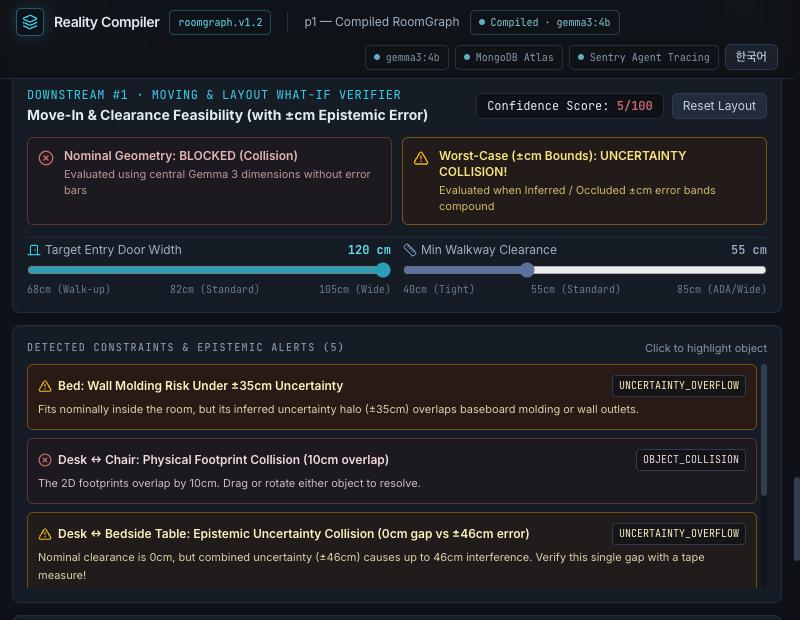
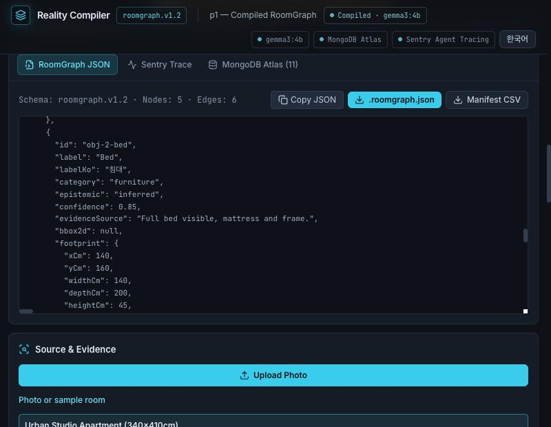
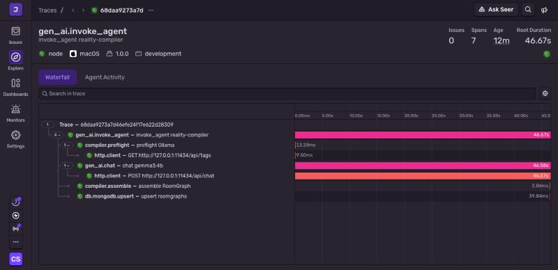
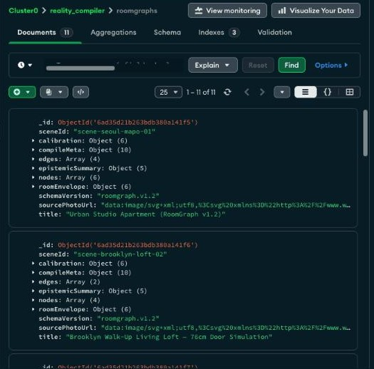
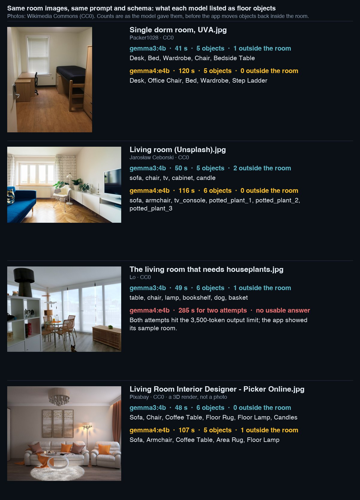

<h1 align="center">Reality Compiler</h1>

<p align="center">
  <b>A room photo in. A RoomGraph out, with ±cm bounds on what Gemma guessed.</b><br>
  An open-source tool that compiles one room photo into checkable spatial data and a 3D view,
  and says which objects it saw and which it only inferred.
</p>

<p align="center">
  <a href="https://github.com/scs0209/reality-compiler/actions/workflows/ci.yml"></a>
  <a href="LICENSE"></a>
  
  
  
</p>

<p align="center">
  <a href="#-quick-start"><b>⚡ Quick start</b></a> ·
  <a href="https://dev.to/scs0209/reality-compiler-gemma-3-turns-a-room-photo-into-data-you-can-check-including-what-it-cant-see-3f5c"><b>📝 Read the write-up</b></a> ·
  <a href="#-how-it-works">How it works</a> ·
  <a href="#-what-i-measured">What I measured</a> ·
  <a href="#-faq">FAQ</a>
</p>

<p align="center">
  
</p>

<p align="center"><sub>The GIF is stitched from screenshots of one real <code>gemma3:4b</code> compile (about 48 s, the wait is cut), not a continuous screen recording.</sub></p>

---

Reality Compiler sends one photo and a reference object of known size (a 210 cm door frame by
default) to **Gemma 3 4B running on your own machine through Ollama**, and turns the answer into a
**`roomgraph.v1.2`** document: room size, floor objects with footprints, the relations between
them, and for every object whether it was **observed**, **inferred** or an **occluded prior**,
with a **±cm** band. The same graph drives a 3D view, a 2D blueprint and a moving what-if check.

MIT licensed, runs locally, no account. Nothing leaves your machine unless you opt in to Sentry,
MongoDB Atlas or a remote Ollama (see [Optional integrations](#-optional-integrations)).

## ✨ Why Reality Compiler

| | |
|---|---|
| 🧾 **Says how it knows** | Every object is `observed`, `inferred` (capped at 0.85 confidence) or `occluded_prior` (capped at 0.6), with a position and size band in cm, and a reason in words. |
| 🧊 **3D that doesn't pretend** | Three.js volumes, not a textured mesh: solid = observed, dashed = inferred, dotted = occluded, plus an optional ±cm shell. Drag an object across the floor to move it. |
| 🚚 **Moving what-if** | Set the entry-door width and the walkway clearance, inject a bed or a sofa, and see collisions twice: nominal geometry and worst case with the ±cm bands added. |
| 🧮 **A formula, not an oracle** | The moving price range (P10 / P50 / P90, in KRW) is a hand-written rule over volume, weight and the number of uncertain items. It is not a trained model. |
| 🛡 **Honest failures** | If Gemma can't produce a valid answer, the app shows a sample room under an amber banner that says it is **not your photo**, and does not save it. |
| 🔍 **Traceable (optional)** | Each compile can be sent to Sentry as a `gen_ai.invoke_agent` trace with measured durations and Ollama's real token counts, and stored in MongoDB Atlas. |

<p align="center">
  
</p>

## ⚡ Quick start

You need **Node 20+** and **[Ollama](https://ollama.com)**:

| What | Command |
|---|---|
| Install dependencies | `npm install` |
| Download the model (3.4 GB) | `ollama pull gemma3:4b` |
| Start the API and the web app | `npm run dev` |

Then open **http://127.0.0.1:5173**, upload a PNG, JPEG or WebP, set the reference object and wait.
On my 16 GB Mac a compile takes about 40 to 50 seconds, and 90 to 110 seconds when Gemma's first
answer is rejected and it gets a second try. The API health check is at
`http://127.0.0.1:8787/api/health`.

> **About the model:** this repository contains no model weights. `gemma3:4b` is downloaded from
> Ollama and is under Google's own terms, not the MIT License. See [License](#-license).

Check your setup with `npm run typecheck && npm test && npm run build`.

## 🔌 Optional integrations

Everything below is off until you configure it. Copy [.env.example](.env.example) to `.env`
(git-ignored), fill in what you use and restart the dev server. Variables already set in the real
environment override the file.

| Want | Set | What happens |
|---|---|---|
| **Sentry agent tracing** | `SENTRY_DSN` | Each compile is sent as a `gen_ai.invoke_agent` trace with `compiler.preflight`, `gen_ai.chat`, `compiler.assemble` and `db.mongodb.upsert` spans. Photos, file names and prompts are never attached. Without a DSN the header and `/api/health` say "not sending". |
| **MongoDB Atlas** | `MONGODB_URI`, `MONGODB_DB` | Compiled RoomGraphs are upserted into a `roomgraphs` collection. **This stores the uploaded photo with each RoomGraph**, so it is an explicit opt-in. |
| **Another Ollama host or model** | `OLLAMA_BASE_URL`, `GEMMA_MODEL`, `GEMMA_TIMEOUT_MS` | Points the compiler at a remote Ollama or a different model. Check that model's license. |

## 📸 Screenshots

| | |
|---|---|
|  |  |
| **Photo stays next to the graph** — no boxes, because the model can't place them | **Inspector** — the bed was put outside the room, so it was moved inside and marked inferred |
|  |  |
| **What-if** — nominal collision and worst-case ±cm collisions | **RoomGraph JSON** — per object: epistemic state, confidence, footprint |
|  |  |
| **Sentry** — one compile, 99.8% of it in the model call | **MongoDB Atlas** — the `roomgraphs` collection |

## 📊 What I measured

Five room images (four CC0 files from Wikimedia Commons, one bedroom photo of unknown source), run
through the app's own request with two models: same prompt, same schema, temperature 0, one run
each ([credits](docs/post-images/CREDITS.md)).

| | `gemma3:4b` (default) | `gemma4:e4b` |
|---|---|---|
| Size in Ollama | 3.4 GB | 6.6 GB |
| Time per photo | 40 to 51 s | 107 to 120 s |
| Output tokens per attempt | 1.2k to 1.4k | 2.4k to 2.9k |
| Photos that ended in a usable RoomGraph | 5 of 5 | 4 of 5 |
| Objects the model placed outside the room | 4 of 28 | 2 of 20 |

<p align="center">
  
</p>

**This is not a benchmark.** Five images, one run each, no labelled ground truth, one image a 3D
render, and a difference of one or two objects is noise at this size. I did not tune the prompt
or raise the output limit for Gemma 4, so it compares one setup, not the models. `gemma4:e4b`
failed on the busiest room (both attempts hit the 3,500-token output limit), and the app showed its
sample room after 285 s. The full discussion is in the [write-up](https://dev.to/scs0209/reality-compiler-gemma-3-turns-a-room-photo-into-data-you-can-check-including-what-it-cant-see-3f5c).

## 🧠 How it works

* **Schema first.** `roomgraph.v1.2` is a Zod schema ([shared/roomGraphSchema.ts](shared/roomGraphSchema.ts)).
  Every graph, from Gemma or from a sample, has to pass it.
* **Ask the model for less.** Gemma gets the photo, the reference object and a JSON Schema that
  Ollama uses to constrain decoding. It returns the room size, the objects, the openings and the
  blind spots. Ids, relations between objects (from footprint geometry) and the epistemic counts
  are computed in code.
* **Don't trust the model's confidence.** `inferred` objects are capped at 0.85 and
  `occluded_prior` at 0.6, and the number of capped objects is recorded.
* **Floor objects only, inside the room.** Openings, wall-mounted items and things resting on
  furniture are skipped (and counted). An object the model puts outside the room is moved back
  inside, marked `inferred` with a wider ± band, and the move is written into its reason.
* **Correct what is harmless, reject what is wrong.** A ceiling height reported in millimetres
  (1800 to 6000) is read as mm and anything else out of range is clamped, and each correction is
  recorded. Room width and depth keep strict checks, because a "corrected" room size is just a
  wrong one.
* **No boxes on the photo.** On a real photo `gemma3:4b` could not place boxes, so the model is
  not asked for them: `bbox2d` is `null` and the UI says so.
* **Failures look like failures.** A rejected answer is retried once with the validation error in
  the prompt. If that fails too, the user sees a sample room, the reason and an amber banner.
  Token counts come from Ollama and durations are measured; nothing is padded.

The deep dive, with what broke along the way, is in the
[write-up](https://dev.to/scs0209/reality-compiler-gemma-3-turns-a-room-photo-into-data-you-can-check-including-what-it-cant-see-3f5c).

## 🧩 Built with

| Part | Where | What it does here |
|---|---|---|
| **Gemma 3 4B** (Ollama) | [server/gemmaCompiler.ts](server/gemmaCompiler.ts), [server/gemmaScene.ts](server/gemmaScene.ts) | Vision model that turns the photo into the scene; prompt, JSON Schema and parser live here. |
| **Sentry** | [server/sentryAgentTracer.ts](server/sentryAgentTracer.ts) | Manual `gen_ai` agent tracing, shared with the in-app span waterfall. Optional. |
| **MongoDB Atlas** | [server/atlasStore.ts](server/atlasStore.ts) | Upserts compiled RoomGraphs into `roomgraphs` (unique `sceneId` index and a text index). Optional. |
| **Entire CLI** | [.entire/settings.json](.entire/settings.json) | The agent sessions this project was built in were recorded with Entire (checkpoints in a separate private repository). I have switched recording off. |
| **GitHub Actions / Copilot** | [.github/workflows/ci.yml](.github/workflows/ci.yml), [.github/copilot-instructions.md](.github/copilot-instructions.md) | CI runs typecheck and tests on every push and PR to `main`. The Copilot file states the project's invariants. |

[`.do/app.yaml`](.do/app.yaml) and [`deploy/digitalocean-gpu-ollama.sh`](deploy/digitalocean-gpu-ollama.sh)
are drafts for a DigitalOcean deployment. **I have not deployed with them**, and there is no hosted
demo: Reality Compiler runs locally.

## 🛠 Project layout

```text
server/gemmaCompiler.ts      compile pipeline: preflight, Ollama call, retry, fallback, save
server/gemmaScene.ts         prompt, JSON Schema, parser (floor-only filter, move-inside, ceiling fix)
server/sentryAgentTracer.ts  manual gen_ai tracing (optional)
server/atlasStore.ts         MongoDB Atlas store (optional)
server/index.ts              Express API: /api/compile, /api/what-if, /api/roomgraphs, /api/traces, /api/health
shared/roomGraphSchema.ts    Zod schema roomgraph.v1.2
shared/spatialEngine.ts      what-if checks (nominal and worst case) and the rule-based moving quote
shared/presetRooms.ts        three hand-authored sample rooms, labelled as such
src/                         React + Tailwind UI, Three.js 3D view, 2D blueprint, inspector
tests/                       Vitest: compiler, schema, scene kinds, Sentry tracing
docs/post-images/            screenshots and figures used above, with CREDITS.md
```

## ❓ FAQ

<details><summary><b>Does it measure my room?</b></summary>

No. It estimates from one photo, and a 4B model's geometry is rough: positions and sizes are
guesses, which is why every object carries a label, a reason and a ±cm band. There is no
pixel-level calibration; the scale comes from Gemma's estimate using the reference object, and the
app shows `px/cm: n/a` instead of inventing a ratio. Use a tape measure for anything that matters.
</details>

<details><summary><b>Where does my photo go?</b></summary>

To the Ollama server you configure, which is `http://127.0.0.1:11434` (your machine) by default.
Sentry traces contain timings and token counts, never photos, file names or prompt text. If you set
`MONGODB_URI`, the compiled RoomGraph is saved to your Atlas cluster **and that includes the
photo**. Leave it unset if you don't want that.
</details>

<details><summary><b>Is the moving quote a trained model?</b></summary>

No. It is a hand-written formula over movable volume, weight, items that need disassembly and the
number of inferred or occluded items. P50 is the formula's output; P10 and P90 are fixed heuristic
spreads, not calibrated quantiles. A tabular model such as TabPFN is not integrated.
</details>

<details><summary><b>Why did I get an amber banner and a sample room?</b></summary>

Gemma was unreachable, timed out, or gave an answer that failed validation twice. The banner says
why, and the sample is not saved. The three rooms in the sidebar are hand-authored samples and
loading one does not call a model.
</details>

<details><summary><b>Why are there no object boxes on my photo?</b></summary>

On a real photo `gemma3:4b` put boxes in the wrong place (the bed's box over the window, a chair's
box over a shelf), so the model is no longer asked for them. Only the hand-authored samples draw
boxes on their photo.
</details>

<details><summary><b>Can I use another model?</b></summary>

Set `GEMMA_MODEL` to another vision model that Ollama serves. The result is labelled with the
model that answered (`ollama-<model>`). I only tried `gemma4:e4b` besides the default
([above](#-what-i-measured)); other models are untested, and the output has to pass the same schema.
Check the license of whatever you pick.
</details>

<details><summary><b>Is there a hosted demo?</b></summary>

No. It runs locally. The GIF above is the closest thing to a demo.
</details>

## 🤝 Contributing

Bug reports, ideas and pull requests are welcome. Before opening a PR, run
`npm run typecheck && npm test && npm run build`. The invariants a change must keep (uncertainty on
every node, nominal and worst-case checks, measured spans only, failures shown as failures) are
written down in [.github/copilot-instructions.md](.github/copilot-instructions.md).

## 📄 License

The code in this repository is released under the [MIT License](LICENSE). Third-party dependencies
keep their own licenses.

### Gemma is licensed separately

This repository contains **no model weights**. Reality Compiler calls `gemma3:4b` through Ollama, and you download that model yourself with `ollama pull gemma3:4b`. The weights are **not** covered by the MIT License. They are provided by Google under the [Gemma Terms of Use](https://ai.google.dev/gemma/terms) and its Prohibited Use Policy, and those terms apply to everyone who uses them.

- **Using Gemma** means accepting those terms, including the Prohibited Use Policy.
- **Distributing Gemma** (or models derived from it) means passing the use restrictions on to recipients and giving them a copy of the terms. The terms count making Gemma available as a hosted service over an API as distribution, so check them before running a public deployment backed by a Gemma server.
- **Other models:** the Gemma Terms of Use cover the Gemma 1, 2, 3 and 3n families, and Gemma 4 has its own license. If you point `GEMMA_MODEL` at a different model, check that model's license.
- **Outputs:** Google states that it claims no rights in what Gemma generates.

This is a summary of public text as of 2026-10-17, not legal advice. Read the current terms before relying on it.

<sub>Reality Compiler was built for the Hacktoberfest Open-Source AI Challenge Week 2 (Side Hustle). It is an independent project, and its estimates are not measurements.</sub>
